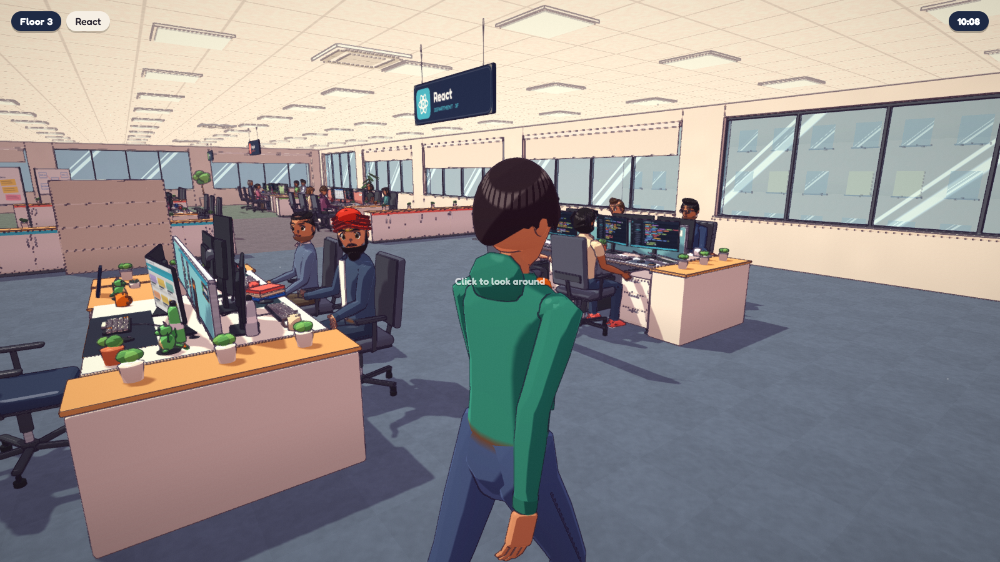
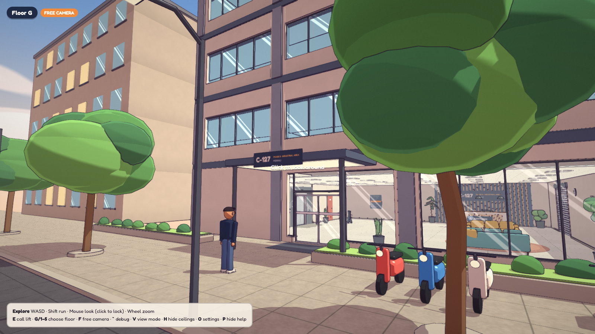
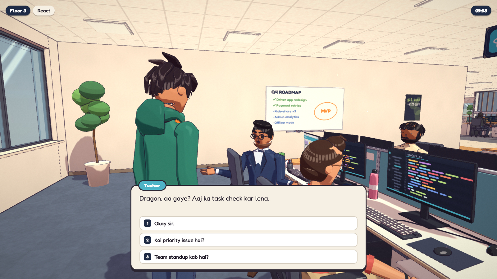
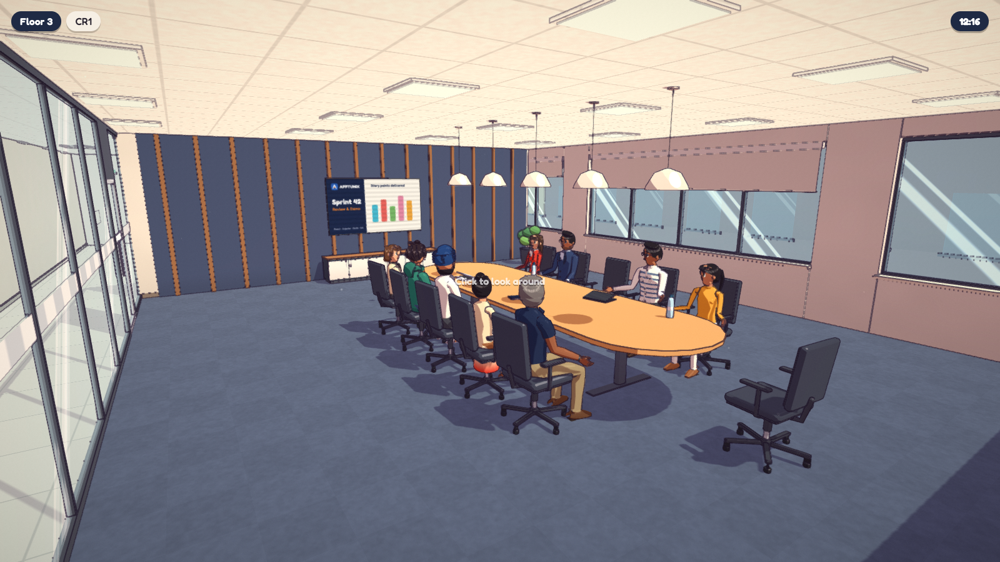
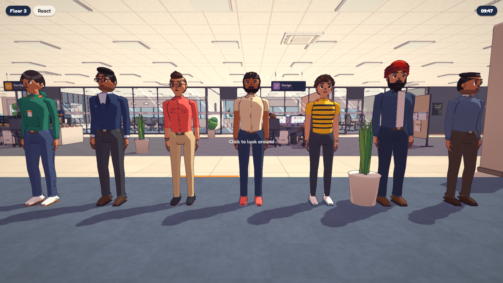

# APPTUNIX: Office Chaos

A stylised, story-driven 3D office adventure that runs entirely in the browser. It's a fictional, hand-crafted version of the Apptunix office in Mohali, inspired by the illustrated look of [Messenger](https://messenger.abeto.co/).

Built with **Babylon.js · TypeScript · Vite · React**. It renders on **WebGPU** and falls back to **WebGL 2** automatically.



| | |
|---|---|
|  |  |
|  |  |

---

## Status

| Phase | Scope | Status |
|---|---|---|
| **1. Environment** | Building, lift, 3rd-floor office (Reception, HR, React, Angular, Node.js, DevOps, Design, QA, CR1–3, break area), toon shading, outlines, lighting | ✅ Done |
| **2. Characters & living office** | Playable DRAGON, 31 NPCs, schedules, Recast navigation, sitting, computer, meetings, branching dialogue | ✅ Done |
| **3. Gameplay & story** | Chapter 1 "The Production Bug": six missions, developer-computer mini-games, cinematics, save/load | ✅ Done |
| **4. Living office** | Walking-validated chapter, five side jobs, story consequences, office details, NPC micro-breaks | 🟡 Built; browser re-test pending |

Progress reports: [Phase 1](docs/ENVIRONMENT_PROGRESS.md) · [Phase 2](docs/PHASE_2_PROGRESS.md) · [Phase 3](docs/PHASE_3_IMPLEMENTATION.md) · [Phase 4](docs/PHASE_4_IMPLEMENTATION.md) ([tests](docs/PHASE_4_TEST_RESULTS.md))

---

## Features

**World**
- Six-storey building with a street front, a working lift (call buttons, sliding doors, floor indicator, chime) and automatic doors.
- A fully furnished 3rd floor: department workstations with personal props, three distinct meeting rooms, pantry, lounge and server room.
- A custom toon renderer: banded cel shading, coloured shadows, screen-space illustrated outlines, a custom shadow map and a warm colour grade. No bloom, no photoreal materials.

**Characters**
- **DRAGON**, the playable React developer: a hand-tuned hero model on a 31-bone rig with a face that blinks, makes expressions and tracks what it looks at.
- **Movement:** acceleration-limited locomotion with momentum, lean into acceleration and braking, banking in turns, and stride-locked walk and run cycles so the feet don't slide.
- **The React team:** Tushar, Mohit, Arpit, Vibhu, Rockey and Karan, plus at least four people in every other department, HR, a receptionist and support staff.

**Living office**
- An in-game clock drives the day: arrival, focused work, stand-ups, meetings in CR1–3, chats, lunch, chai breaks and going home.
- NPCs walk on a Recast nav mesh with crowd avoidance and stuck recovery, open doors, and turn their heads to follow DRAGON.

**Interactions**
- Talk to anyone, sit at any free chair (one person per chair), and use DRAGON's computer (boot sequence plus a fictional desktop).
- Drink water, make coffee, read boards and call the lift.
- Data-driven branching dialogue in Hinglish, with an over-the-shoulder conversation camera.

**Chapter 1 — The Production Bug**
- Six missions: arrival, the CR1 stand-up ("bas ek chhota sa change hai"), a React state-mutation bug, a QA mobile-layout rejection, a chai break with side conversations, and a Friday deploy that ends in a team cinematic.
- DRAGON's workstation runs a fictional desktop: Task Board, Code Editor (find the bug, choose a fix, run tests, hints and retries), Team Chat, Terminal and Browser Preview.
- The deploy terminal is a simulation. Input goes through an allowlisted parser, and nothing is ever executed.
- Quest HUD with a waypoint marker, a journal (**J**), an office map (**M**), relationship choices, autosave, Continue / New Game / Reset, and save export/import.

---

## Getting started

Requirements: **Node 20+** and a current desktop browser (Chrome or Edge recommended for WebGPU).

```bash
git clone https://github.com/SHEKHAR3512/apptunix-office-chaos.git
cd apptunix-office-chaos
npm install
npm run dev            # → http://localhost:5173
```

Production build:

```bash
npm run build && npm run preview
```

### URL options

| Parameter | Effect |
|---|---|
| `?renderer=webgl` / `?renderer=webgpu` | Force a rendering backend |
| `?quality=low\|medium\|high\|ultra` | Graphics preset |
| `?start=office` / `?start=react` | Skip the street and spawn on the 3rd floor |
| `?time=11:00` | Start the office clock at a given time |
| `?diag=1` / `?seed=N` | Dev only: navigation diagnostics panel / pin NPC day variety |
| `?new=1` / `?continue=1` | Skip the title screen: start a new story or continue the saved one |

### Controls

| Input | Action |
|---|---|
| **WASD** · **Mouse** | Move · look (click the game to lock the mouse) |
| **Shift** · **Right mouse** · **Wheel** | Run · strafe · zoom |
| **E** | Interact: talk, sit, use the computer, drink, read, call the lift |
| **X** | Stand up |
| **1–3** | Pick a dialogue reply |
| **G / 1–5** | Choose a floor inside the lift |
| **J** · **M** · **U** | Journal · map · hide the quest HUD |
| **Esc** | Pause / leave the computer |
| **F** · **`** · **V** · **H** | Dev builds only: free camera · debug overlay · render debug views · hide ceilings |

---

## Testing

```bash
npm test               # Vitest: schedules, dialogue, seats, missions, puzzles, terminal, saves
npm run test:e2e       # Playwright: Phase 2 checks + full Chapter 1 playthrough, WebGL 2 and WebGPU
npm run playtest       # scripted street → lift → office → React walk-through
npm run shots          # captures every named viewpoint into docs/screenshots/
```

The browser suites need Google Chrome installed. Playwright starts the dev server automatically.

---

## Project structure

```
src/
  core/          game loop, engine (WebGPU/WebGL 2), floors, settings, input
  rendering/     toon shaders, outlines + grade, shadows/lighting, palette, sky
  assets/        code-driven modelling kit, materials, texture atlas, prefabs
  world/         layout data, architecture, building, floors, lift, doors, colliders
  environments/  each department and room
  game/
    characters/  rig, appearance, DRAGON hero model, animator, factory
    player/      movement physics, animation controller, camera
    npc/         schedules, state machine, Recast navigation, manager
    interactions/ dialogue/  OfficeLife.ts (ties it all together)
  data/          characters, dialogues, schedules (edit content here)
  ui/            React overlays: HUD, dialogue, computer, settings, pause
tests/           unit/ (Vitest) and e2e/ (Playwright)
docs/            art direction, office references, progress reports, screenshots
art-source/      Blender handoff (exported reference GLBs and conventions)
```

**Editing content**
- **People:** `src/data/characters/roster.ts`
- **Lines:** `src/data/dialogues/`
- **Routines:** `src/data/schedules/`
- **Office layout:** `src/world/OfficeLayout.ts`

---

## Art direction & notes

- Read [`docs/ENVIRONMENT_ART_DIRECTION.md`](docs/ENVIRONMENT_ART_DIRECTION.md) before adding assets.
- Models are currently **code-modelled** (procedural meshes and skin weights). The GLB pipeline and Blender conventions in `art-source/` let artist-made models replace them.
- The **office layout is provisional**: no public floor plan or photos were available. See [`docs/APPTUNIX_OFFICE_REFERENCES.md`](docs/APPTUNIX_OFFICE_REFERENCES.md).
- **All characters, names outside the React team, dialogue, systems and incidents are fictional.** No real likenesses are used. The Apptunix logo and colours are placeholders until official assets are supplied.
- No assets were taken from *Messenger*; only its general visual language inspired the look.

---

*Private project for the Apptunix team.*
